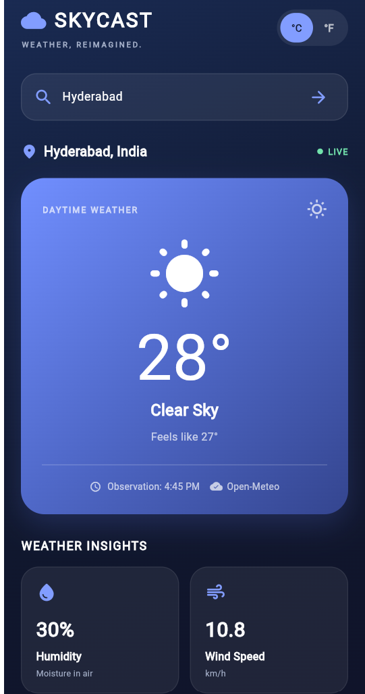
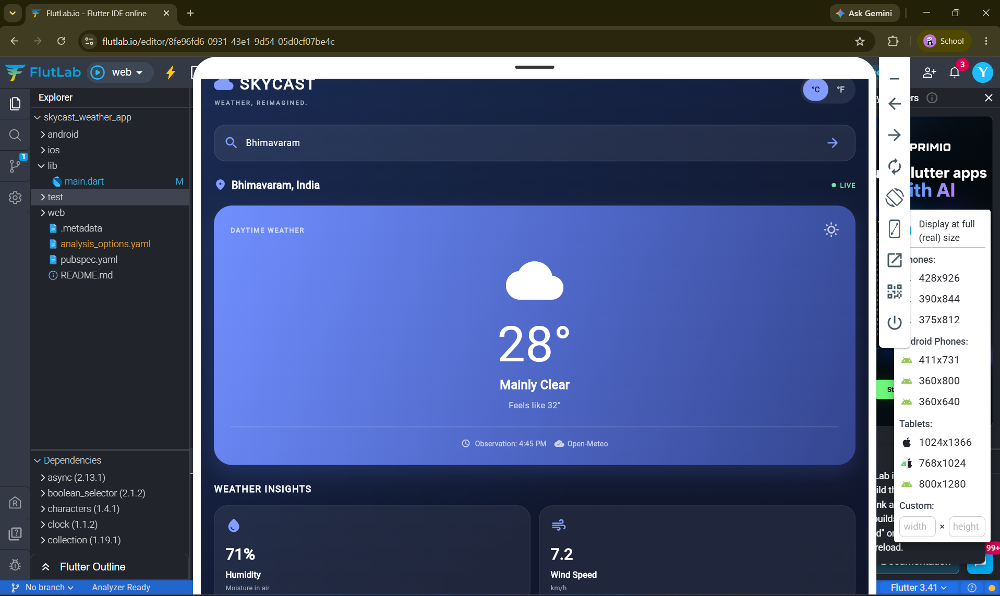
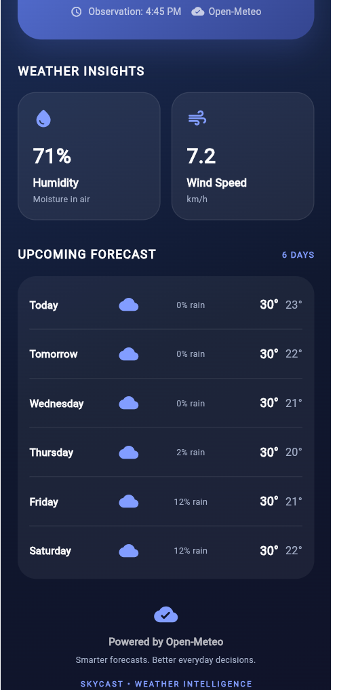
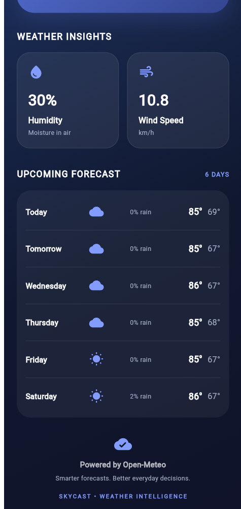
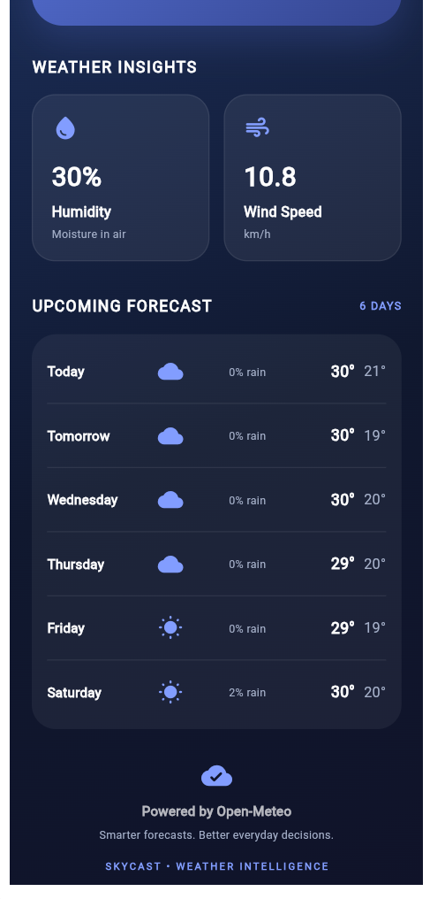
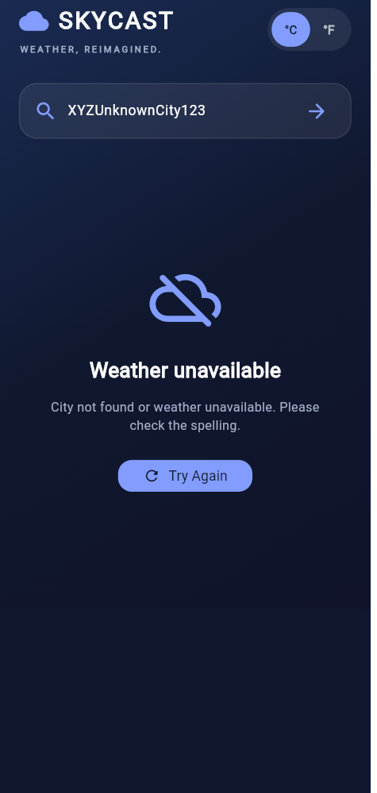

# ☁️ SkyCast – Weather, Reimagined

**SkyCast** is a modern Flutter weather application designed to deliver real-time weather updates, city-based weather search, and a 6-day weather forecast through the Open-Meteo API.

Featuring an elegant interface, live weather information, and useful forecast insights, SkyCast makes checking the weather simple and enjoyable.

<p align="center">
  <strong>Weather, Reimagined.</strong>
</p>

---

## 📱 Application Screenshots

### 1. Home Dashboard
Real-time weather information with a clean and modern interface.



### 2. Weather Forecast
View upcoming weather conditions, temperatures, and rainfall probability.



### 3. Celsius Temperature Display
View weather information in Celsius.



### 4. Fahrenheit Temperature Display
Switch between Celsius and Fahrenheit effortlessly.



### 5. Weather Details
Explore humidity, wind speed, and detailed forecast information.



### 6. Error Handling
Displays a helpful message when an invalid city is entered.



---

## ✨ Key Features

- 🌤️ **Live Weather Updates** – Fetches current weather information using the Open-Meteo API.
- 🔍 **City Search** – Search for weather information in different cities.
- 🌡️ **Temperature Conversion** – Switch between Celsius (°C) and Fahrenheit (°F).
- 📅 **6-Day Weather Forecast** – View upcoming weather conditions and temperatures.
- 💧 **Humidity Information** – Displays current humidity levels.
- 🌬️ **Wind Speed** – Provides wind speed information in km/h.
- 🌧️ **Rain Probability** – Shows the probability of rainfall.
- 🔄 **Pull-to-Refresh** – Reload weather information.
- ⚠️ **Error Handling** – Handles invalid city names and unavailable weather data.
- 📱 **Responsive Interface** – Modern mobile-friendly design.

---

## 🛠️ Technologies Used

| Technology | Purpose |
|---|---|
| Flutter | Cross-platform application development |
| Dart | Programming language |
| Open-Meteo API | Live weather and forecast data |
| HTTP | API communication |
| Material Design | User interface components |

---

## 🌐 API Integration

SkyCast uses the free Open-Meteo services:

- **Geocoding API** – Finds city coordinates using city names.
- **Forecast API** – Retrieves current weather conditions and forecast information.

**API Provider:** [Open-Meteo](https://open-meteo.com/)

No API key is required for the standard Open-Meteo API.

---

## 🚀 Getting Started

### Prerequisites

- Flutter SDK
- Dart SDK
- Visual Studio Code or Android Studio
- Internet connection

### Installation

**1. Clone the repository**

```bash
git clone https://github.com/ripika23/SkyCast-Weather-App.git
```

**2. Navigate to the project directory**

```bash
cd SkyCast-Weather-App
```

**3. Install dependencies**

```bash
flutter pub get
```

**4. Run the application**

```bash
flutter run
```

---

## 📂 Project Structure

```text
SkyCast-Weather-App/
│
├── lib/
│   └── main.dart
│
├── screenshots/
│   ├── 01-home-dashboard.png
│   ├── 02-weather-forecast.png
│   ├── 03-celsius-forecast.png
│   ├── 04-fahrenheit-forecast.png
│   ├── 05-weather-details.png
│   └── 06-error-handling.png
│
├── test/
├── pubspec.yaml
├── analysis_options.yaml
└── README.md
```

---

## 🎯 Project Objective

The objective of SkyCast is to develop a user-friendly weather application that integrates real-time API data with an attractive interface while demonstrating Flutter development, API integration, asynchronous programming, and responsive UI design.

---

## 👩‍💻 Developer

**Yekula Ripika**

Computer Science and Engineering  
Vishnu Institute of Technology

---

## 📜 License

This project is available under the MIT License.
